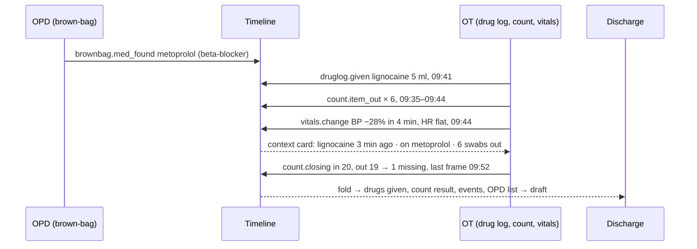

# 01 — Product and modules (shared by both specs)

## 1. The idea in one paragraph

A patient's morning moves through three places: the OPD, the OT, and the ward at discharge. Today each
place writes its own paper. This extension keeps **one append-only timeline per patient**. Each module adds
events to it ("swab counted out", "lignocaine 5 ml given", "BP 86/50"). Other modules read those events.
The discharge summary is then a view over the timeline, not a fresh document typed from memory.

Analogy: the timeline is a flight data recorder. Each instrument (module) writes to it. The recorder never
flies the plane; the crew (doctor, nurse, anaesthetist) does.

## 2. Corrections to the original brief

The brief was written against an older design document. The repo has moved on. These facts win.

| Brief said | The repo actually has | Effect on the spec |
|---|---|---|
| "No code exists yet"; the hackathon becomes the first code | A live product: FastAPI, ~200 test files, multi-clinic, deployed at gsr.lightday.online | Hackathon rules on pre-existing code matter (README D1). Isolate new code in `hx/`. |
| Speech provider interface with two implementations | `SttProvider` protocol (`doctor_dictation/providers/stt/base.py:38`) with openai, groq, assemblyai, muse, local, onnx, browser, stub | Muse Voice Transcribe already exists (`providers/stt/muse.py`), uncommitted. No new speech adapter needed. |
| FHIR-style tables: `observation`, `procedure_record`, `medication_request`, `allergy_intolerance`, `audit_event` | `patients`, `encounters`, `documents.structured_json`, `audit_log` (`db/migrations/001_init.sql`) | The timeline is a new table (`02` §4), linked to `patients` and `encounters`. |
| pdfmake writes the PDF | Headless Chromium renders HTML to PDF (`doctor_dictation/pdf/renderer.py:1`) | Discharge draft reuses `pdf/sections.py` and the renderer. |
| Muse Spark via the Meta Model API | `LLM_PROVIDER=meta` exists but assumes an OpenAI-style endpoint, "not yet verified" (`config.py:70`) | Day 0 spike S2 verifies it before anything depends on it. |
| Vitals extraction is new | Dictated vitals already parse into five fields (`core/vitals.py:9`, `VITAL_KEYS`) | Reuse the field names and units for monitor readings. |

## 3. Modules

Each module has: an input port, a pure rule core, timeline events it writes, events it reads, and a tier.

### 3.1 Rx dictation (exists)

- **Does:** voice → transcript → structured, grounded prescription → confirm gate → PDF.
- **New:** on save, writes one `rx.saved` event pointing at the `documents` row. Nothing else changes.
- **Tier:** documentation.

### 3.2 Brown-bag medicine review (OPD)

The patient tips their bag of medicines onto the desk. The doctor photographs the strips.

- **Input:** one or more photos (camera port, still images).
- **Rule core:** a vision LLM reads the printed name and strength off each strip. The existing lexicon
  grounding (`core/drugnames.py`, `core/rowcheck.py`) maps each name to a known generic, or leaves it
  "as read" with a flag. A small class map tags known classes (e.g. metoprolol → beta-blocker).
- **Writes:** `brownbag.med_found` per strip (name as read, grounded generic, strength, class, photo ref).
- **Reads:** nothing.
- **Tier:** documentation for the list. The **"same drug twice" flag** (two strips, one generic) is
  **decision tier**. It judges this patient's medicines.

### 3.3 Count Guard (OT)

A second counter for swabs (gauze) during surgery. The nurses' manual count stays the record.

- **Input:** a camera over the swab tray and the discard bucket (vision port, frames).
- **Rule core:** SAM 3.1 segments and tracks each swab with a track ID. A swab whose track enters the
  bucket zone is "counted out". Packs opened are "counted in" by voice ("opening ten swabs") or a tap. At the
  closing count, `in − out ≠ 0` is a discrepancy. The card shows the last frame where each unaccounted track
  was seen.
- **Writes:** `count.pack_opened`, `count.item_out`, `count.closing` (with discrepancy and frames).
- **Tier:** **unclear**. It is a safety aid. Get regulatory advice before product launch.

### 3.4 Voice drug log (OT)

- **Input:** push-to-talk speech, e.g. "lignocaine two percent, five ml, local infiltration".
- **Rule core:** parse drug, strength, volume or dose, route, time. Ground the drug name through the same
  lexicon as Rx. Unknown names stay "as heard" and need a tap to confirm, like the Rx confirm gate.
- **Writes:** `druglog.given`.
- **Tier:** documentation.

### 3.5 Vitals context card (OT)

Monitors already alarm when one number crosses a limit. The gap is **why**, shown in one place.

> BP 86/50, down 28% in 4 min · lignocaine 5 ml given 3 min ago (voice log) · on metoprolol (OPD medicine
> review) · 6 swabs into the bucket in the last 10 min (Count Guard) · [open the hypotension checklist]

- **Input:** vitals port (simulated scenario in the hackathon, HL7 feed in the product).
- **Rule core:** trend rules spot the change in milliseconds. A context collector pulls the related events
  from the timeline window. The LLM only rephrases those facts into the card. It never adds a fact.
- **Writes:** `vitals.reading` (sampled), `vitals.change` (rule fired), `vitals.card` (facts + text).
- **Reads:** `druglog.given`, `brownbag.med_found`, `count.item_out`.
- **Tier:** **decision tier.** It analyses monitor signals during time-critical care.
- **Never:** recommends a drug, a dose or an action. The checklist link opens a clinic-supplied checklist.

### 3.6 Discharge draft

- **Input:** the timeline for one episode, plus a dictated operative note.
- **Rule core:** fold the timeline into sections (drugs given, count result, vitals events, OPD medicine
  list). The LLM writes only the narrative paragraph from the dictated note. The doctor edits and signs.
- **Writes:** `discharge.drafted`, `discharge.signed`. Follow-up dates export as an `.ics` file.
- **Tier:** documentation.

## 4. The worked example (the demo story)

## 5. Regulation tiers

| Module | What it does | Tier |
|---|---|---|
| Rx dictation, drug log, discharge draft | Records and formats | Documentation (not a device) |
| Brown-bag list | Reads strips and lists them | Documentation |
| Brown-bag "same drug twice" flag | Judges this patient's medicines | **Decision** (the existing design already gates "duplicate therapy") |
| Count Guard | Counts swabs in and out | **Unclear** — a safety aid; get advice |
| Vitals context card | Analyses monitor signals in time-critical care | **Decision** — clearly regulated |

Basis (from the brief; **verify with a regulatory adviser before product launch**):

- **United States:** FDA clinical decision support guidance keeps software that analyses signals from a
  signal-acquisition system (such as a monitor) inside device regulation. Software that supports
  time-critical decisions also stays a device.
- **India:** the brief reports CDSCO finalised medical-device software guidance in July 2026. Software that
  evaluates a patient's data and recommends counts as SaMD (Software as a Medical Device), with no safe
  harbour. This date is after this document's sources were checked; confirm it.

Consequence for both specs: every decision-tier output carries `tier = "decision"` on its timeline event.
The tier switch (`02` §7) hides and blocks those outputs unless explicitly enabled.

## 6. Data rules

- **Hackathon:** synthetic patient, props, and recorded demo audio only. No real patient data reaches the
  Meta Model API. Never use Muse Spark's "contributor" tier with anything patient-like: Meta may train on it.
- **Product:** local-first. SAM 3.1 has open weights, so vision can run on clinic hardware. Any cloud call
  carries no direct identifiers, has a data-processing agreement, and is logged in `audit_log`.

## 7. GxP: a separate product

GxP (pharma quality: 21 CFR Part 11, EU Annex 11) has a different buyer (pharma QA), user (lab staff) and
rulebook. Share the engine (camera port, speech port, rule checker, report renderer) as a library later.
Do not ship GxP as a module of the doctor app. Not in either spec.
