# Architecture Overview

> Snapshot of `main` @ `90e0f56`, generated 2026-11-02. Companion to [index.html](index.html) — same data, same numbers.

## Summary

- **As built:** two FastAPI + SQLite apps with no shared code. Doctor Dictation serves a vanilla JS single page; Count Guard serves React 19 through Vite.
- **Coupling (2 Nov):** DD pushes admissions to CG `POST /journey/intake` in a background task after Save; CG pulls `GET /api/v1/admissions` on Sync; one intake path makes a push and a Sync racing create one patient.
- **Count Guard core pattern:** an append-only event timeline per patient (`morning.db`). Corrections are new events with `supersedes_id`. Every write raises alerts, runs the ops agent synchronously, and returns a recomputed patient view; SSE streams update the ward list and chart.
- **Doctor Dictation core pattern:** an LLM draft wrapped in deterministic grounding, plus a server-side verify gate. Per-clinic SQLite files sit behind a session middleware, active only in multi-clinic mode.
- **Labels:** each diagram is marked **Implemented** (read from code), **Documented** (described in docs, not all built) or **Proposed** (recommendation). An intended architecture is never shown as built.

**Decision needed:** whether to adopt the Proposed module boundaries (last diagram) as the target.

## Product hierarchy — Implemented

Solid = current product. Dashed = archived to count-guard/archive/ (not mounted). The thick arrow is the DD → CG patient flow added on 2 Nov.

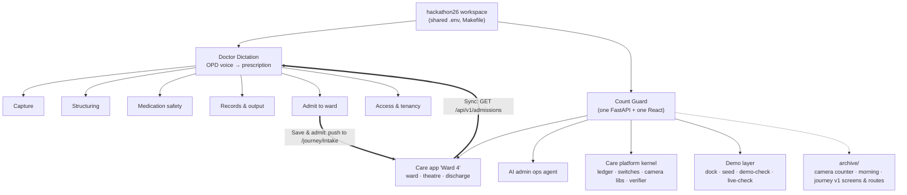

## Application architecture (as built) — Implemented

Two servers, two databases, no shared code. DD pushes admissions to CG; CG pulls them on Sync; CG links to the DD PDF. The legacy camera libraries (core/, engine.py, report/) are now imported by the theatre camera.

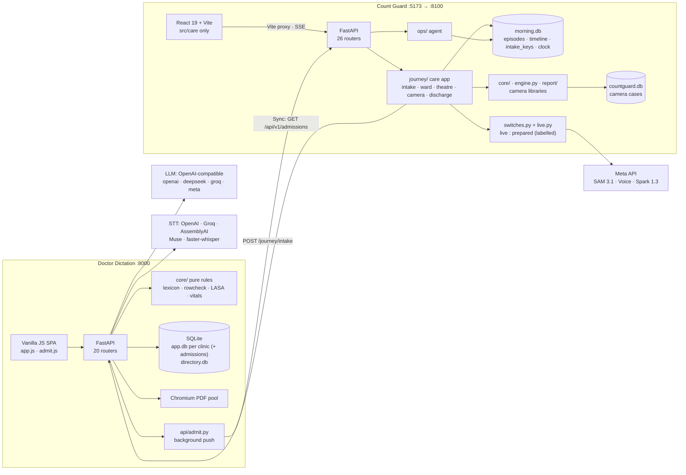

## DD → Count Guard: Save & admit, push, Sync — Implemented

doctor_dictation/api/admit.py:101-178, migration 015_admissions.sql, count-guard journey/intake.py, intake_api.py:78-111, sync.py. Single-clinic DD only; optional CG_SYNC_TOKEN header on both hops; the token never reaches a browser.

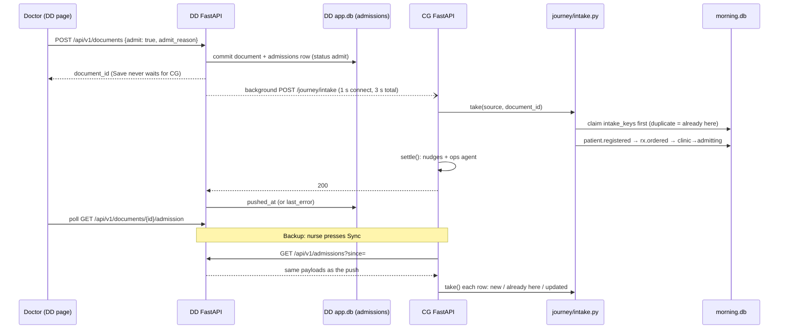

## Count Guard: one write, end to end — Implemented

Every care write recomputes alerts and runs the ops agent synchronously before returning the patient view; the SSE streams then notify the ward list and chart.

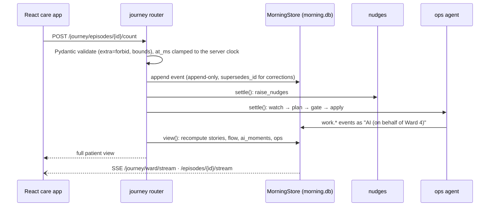

## Swab-count hard stop — Implemented

count_gate in journey/states.py:95-109, unchanged by the consolidation; by_ai in stories.py:245-249 folds look-alike letters. test_route_sweep.py proves only POST …/count writes a person's closing.

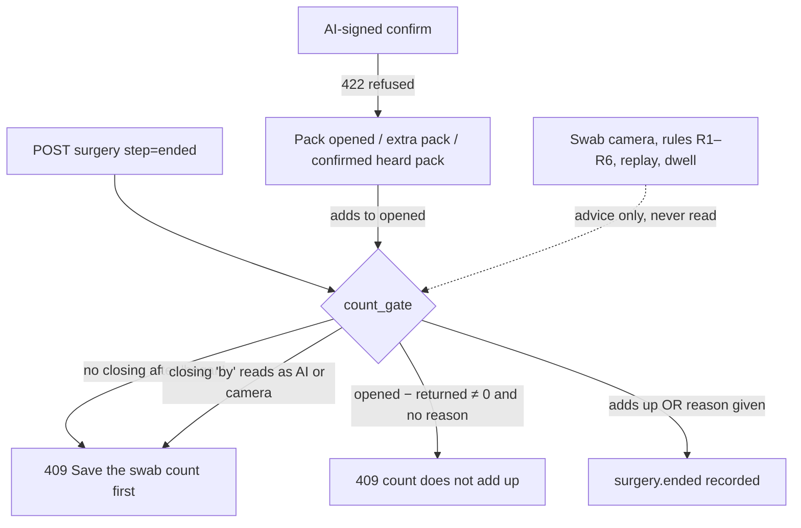

## Patient state machine — Implemented

journey/states.py:130-170 and check_gate.py. The current state is the latest patient.state event. Intake enters at clinic (New patient) or admitting (DD admission).

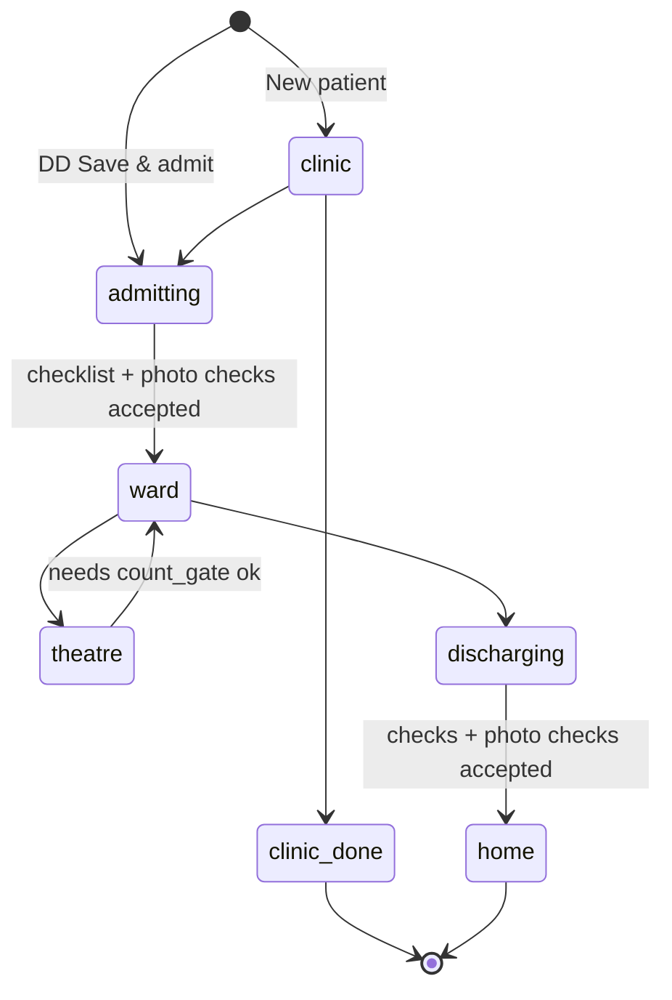

## Doctor Dictation: dictate → save → (admit) — Implemented

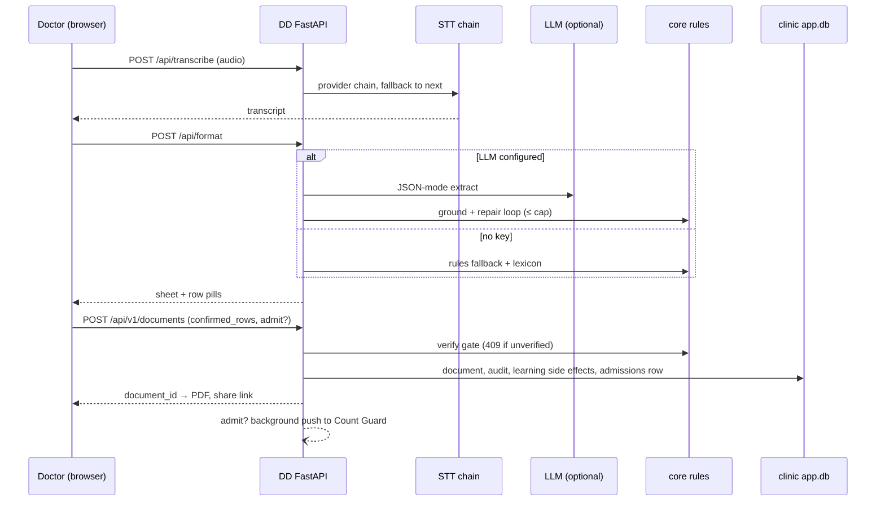

## Authentication & authorisation — Implemented

Doctor Dictation only, and only with MULTI_CLINIC=1 (where intake answers 404). Count Guard has no user authentication: the actor is a free-text 'by' field and role is client UI state. The DD↔CG hops can share an optional CG_SYNC_TOKEN header.

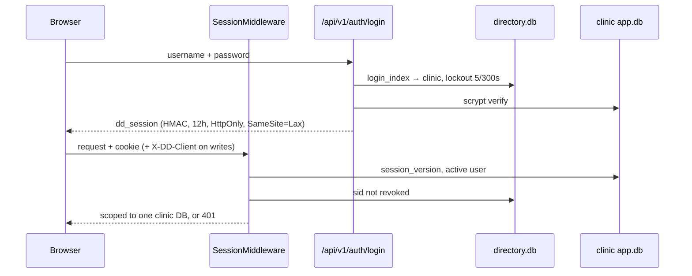

## Data stores — Implemented

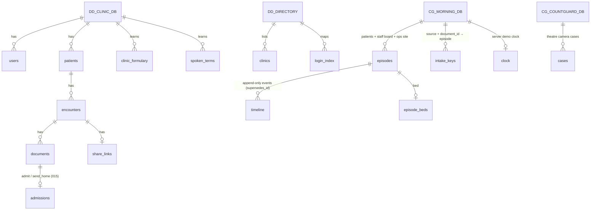

## Deployment — Documented

DD's Docker/Caddy/VPS assets are real; the live pilot (docs/working/2026-10-18-deployment) cannot be verified from code, and 02-deploy.sh clones a separate upstream repo. Count Guard has no deployment assets: local dev only, and the DD→CG push assumes both on one machine (COUNT_GUARD_URL default 127.0.0.1:8100).

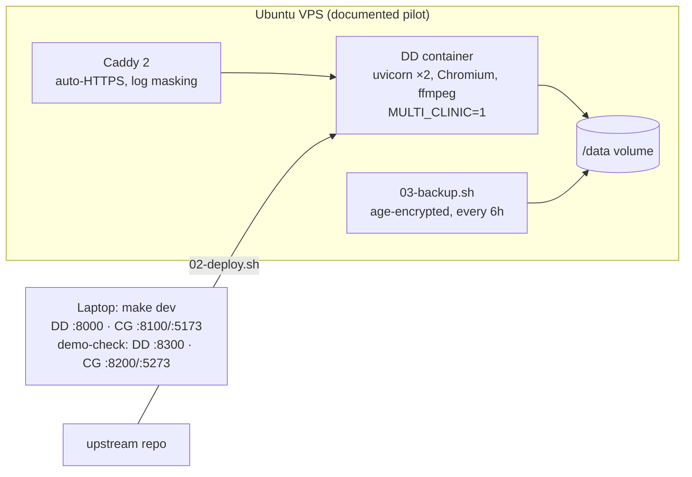

## Originally planned architecture (21 Oct) — Documented

docs/hackathon/02-architecture.md. NOT built: superseded by decisions D1 and J1 (separate Count Guard app, HTTP link) and by the 2 Nov push + Sync design.

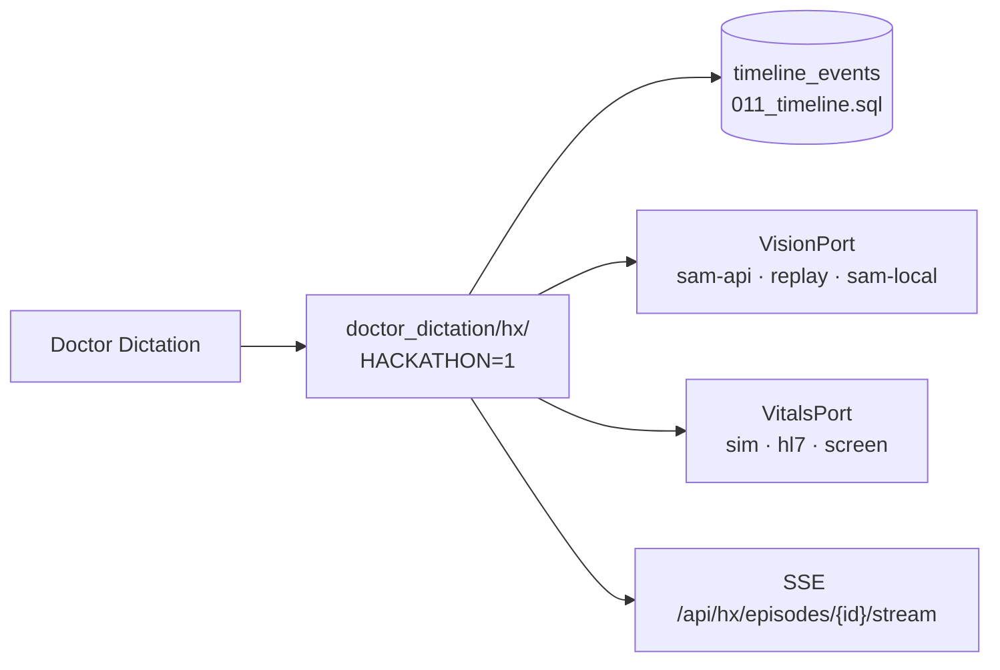

## Recommended module boundaries — Proposed

Recommendation only. The archive step is done (2 Nov); the platform extraction and async ops runner are not.

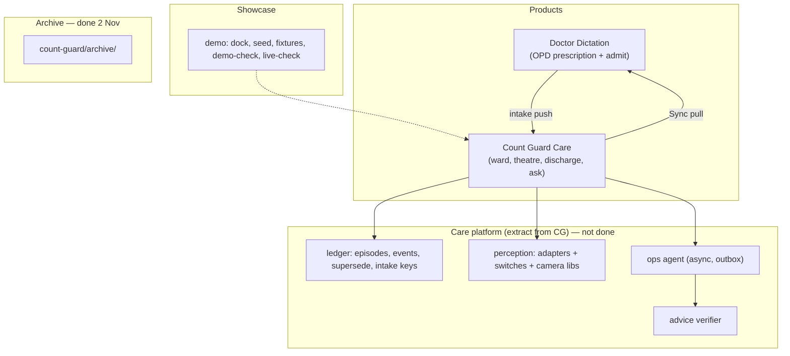

## Technical stack

### Languages

- **Python 3.12** — Both backends
- **JavaScript (ES modules)** — DD vanilla SPA; CG React + Node scripts
- **SQL** — DD numbered migrations (015 admissions)
- **Shell** — DD deploy and backup scripts

### Backend frameworks

- **FastAPI + Uvicorn + Pydantic v2** — Both
- **httpx** — Model clients; DD→CG push and CG→DD Sync
- **python-dotenv** — Shared .env loading

### Frontend

- **Vanilla JS, no build** — Doctor Dictation (app.js 1,406 lines + ~30 modules incl. admit.js)
- **React 19, React Router 7, Vite 6** — Count Guard (care app only)
- **Lightday design system** — Both

### Data

- **SQLite via stdlib sqlite3 (no ORM)** — DD: app.db per clinic (+ admissions) + directory.db
- **SQLite** — CG: morning.db (episodes, timeline, beds, intake_keys, clock) + countguard.db (camera cases)
- **JSON files** — DD lexicon data; CG prepared fixtures

### Real-time / messaging

- **SSE** — CG ward list and chart streams
- **WebSocket** — CG theatre camera live socket (no frontend caller)
- **HTTP push + pull** — DD → CG intake; CG → DD Sync
- **None (synchronous)** — CG ops agent runs inside each request; no queue or broker

### AI / ML

- **OpenAI-compatible LLM client (openai, deepseek, groq, meta)** — DD structuring, correction, letterhead vision
- **STT: OpenAI whisper-1, Groq, AssemblyAI, Meta Muse Voice, faster-whisper** — DD
- **Meta SAM 3.1, Muse Voice Transcribe, Muse Spark 1.3 (text + vision)** — CG, behind live switches; live-checked 2 Nov
- **Muse Spark Open (Baseten)** — CG discrepancy explanation, optional

### Documents & media

- **Playwright headless Chromium** — DD PDF
- **fpdf2** — CG discharge PDF and count sheet
- **segno (QR), Pillow, pillow-heif, pypdfium2** — DD
- **ffmpeg** — Both (audio/video conversion)

### Infrastructure

- **Docker + docker-compose, Caddy 2** — DD only
- **Ubuntu VPS scripts, fail2ban, age backups, rclone** — DD only
- **Makefile (root + per app)** — Both; make dev starts both apps
- **None** — CG has no container or deploy assets

### Testing

- **pytest** — DD 3,361 · CG 921 collected
- **node:test** — CG ≈470 logic tests + 57 demo-harness; DD frontend via node fake-DOM
- **playwright-core + system Chrome** — Two-app demo-check (20 beats)
- **make live-check** — One real call per model, by hand with a key

### External integrations

- **Doctor Dictation ↔ Count Guard HTTP** — Push /journey/intake; Sync /api/v1/admissions; optional CG_SYNC_TOKEN
- **WhatsApp / QR share** — DD patient link (link only, no API)
- **Healthchecks ping, rclone off-site** — DD backup (optional)

## External integrations

| Integration | Used by | Config (names only) | Status |
| --- | --- | --- | --- |
| OpenAI-compatible LLM (openai, deepseek, groq, meta) | Doctor Dictation | LLM_PROVIDER, LLM_MODEL, LLM_VISION_MODEL, *_API_KEY, *_BASE_URL | Implemented; vendors mocked in tests |
| STT: OpenAI, Groq, AssemblyAI, Meta Muse, faster-whisper | Doctor Dictation | STT_CHAIN, STT_ENGINE, WHISPER_* | Implemented; ONNX stub |
| Meta API: SAM 3.1, Muse Voice, Muse Spark 1.3 | Count Guard | MODEL_API_KEY or META_API_KEY, META_API_BASE, SAM_MODEL, VOICE_MODEL, SPARK_MODEL; VOICE_LIVE, PROOF_LIVE, SPARK_LIVE, TRAY/SETUP/SWABS/MEDICINES_LIVE | Implemented behind live switches; live-check answered for all four on 2026-11-02 |
| Baseten: Muse Spark Open | Count Guard (camera close explanation) | BASETEN_API_KEY, SPARK_OPEN_BASE, SPARK_OPEN_MODEL | POC |
| Count Guard intake (push) | Doctor Dictation Save & admit | COUNT_GUARD_URL, CG_SYNC_TOKEN | Implemented |
| Doctor Dictation admissions (Sync pull) and PDF link | Count Guard Sync, chart | DD_BASE_URL / DD_PORT, CG_SYNC_TOKEN | Implemented |
| Headless Chromium (Playwright) | Doctor Dictation PDF; Count Guard demo-check | — | Implemented |

## Authentication and authorisation

- **Doctor Dictation, multi-clinic mode:** scrypt passwords and an HMAC-signed `dd_session` cookie (12 h, HttpOnly, SameSite=Lax). Lockout is 5 failures per 300 s. Logout and `session_version` revoke sessions. A `X-DD-Client` header guards against CSRF. Per-clinic DB scoping uses a ContextVar. Roles are admin, author and owner (`doctor-dictation/doctor_dictation/policy.py:20-44`).
- **Doctor Dictation, single mode (default):** no authentication; CORS `*` (`doctor-dictation/doctor_dictation/api/app.py:81-87`).
- **Count Guard:** no user authentication. The actor is a free-text `by` field, and the role is client-side state. CORS allows localhost only (`count-guard/backend/app/main.py:51-56`).
- **DD ↔ CG:** an optional shared `CG_SYNC_TOKEN` header, checked by both sides when set (`doctor-dictation/doctor_dictation/api/admit.py:163-166`). Without it, intake and admissions accept any local caller. Admissions are single-clinic only (404 with `MULTI_CLINIC=1`).

## Deployment

- **Doctor Dictation:** Dockerfile (Python 3.12, Chromium, ffmpeg, non-root), docker-compose with Caddy 2 auto-HTTPS, and VPS harden, deploy, backup and restore-drill scripts. `02-deploy.sh` clones a separate upstream repo. A live pilot is described in `doctor-dictation/docs/working/2026-10-18-deployment/` and cannot be verified from code.
- **Count Guard:** local development only (`make dev` from the root runs both apps). No container or production configuration exists; the DD → CG push defaults to `http://127.0.0.1:8100`.
