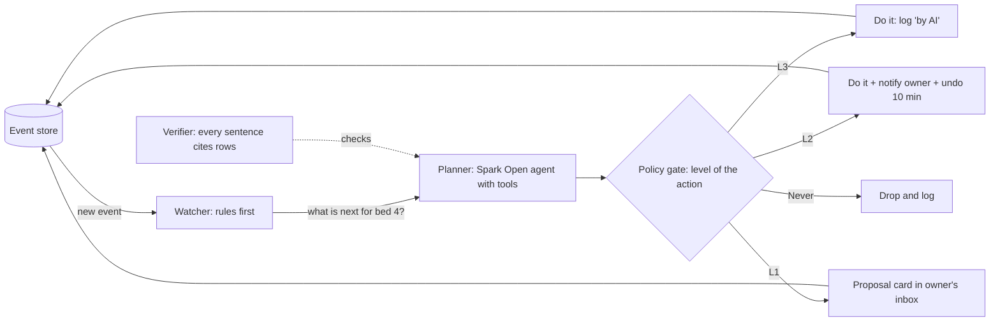

# How could the AI run this clinic? (options; discussion spec, not for build yet)

Owner question, 30 Oct: "evaluate how can we make this AI native — how can we make the AI run this clinic? Are there any options?" This document is for discussion. Nothing in it is scheduled.

## The answer in one paragraph

The AI can **run the clinic's operations** while clinicians keep **every clinical decision**.

- Concretely, an agent watches every event, works out what each patient needs next, and does the non-clinical work itself:
  - routing, chasing and reminders;
  - drafting, counting and reconciling;
  - handovers and patient messages.
- It *proposes* every clinical act (orders, discharge, theatre) for one-tap human approval.

This is option C below. It fits the records-only, no-advice rule that the whole product is built on, and it reuses what exists:
- the event store;
- the four Muse models;
- the sentence verifier.

## What "AI runs it" has to mean here

Today a person drives every step: the doctor dictates, the nurse acknowledges, the nurse records, the doctor answers. The AI only transcribes, reads and counts when asked.

"AI native" means the default flips. **The AI does the next step unless the step needs a human, and then it prepares the step so the human only decides.**

## Autonomy ladder: the single most useful idea

Every action in the system gets a level. The level, not the model, decides what the AI may do.

| Level | AI may… | Examples in Count Guard today |
|---|---|---|
| L0 Inform | show, summarise, answer with citations | ward board, "How is bed 4?", shift summary |
| L1 Propose | prepare a draft a named human approves | orders from dictation, discharge summary, theatre move, answer to a patient |
| L2 Act with undo | do it, tell the owner, keep an undo window of 10 min | acknowledge-and-schedule tasks from signed orders, send reminders, route a question to the free doctor, file a camera count |
| L3 Autonomous | do it silently, log it | transcribe, read a photo, count swabs, timestamp events, chase overdue obs with a nurse nudge |
| Never | — | prescribe, change a dose, advise a patient clinically, clear a count mismatch, discharge |

How the ladder is enforced:
- A `policy.py` table maps `event_type → level`, per site.
- Moving an action up a level is a configuration change with an audit line.
- A kill switch drops every action to L0.

## Options

| | A. Copilot | B. Ward agent (proposes) | **C. Operations agent with a ladder** | D. Multi-agent clinic |
|---|---|---|---|---|
| What runs | Ask bar and summaries | One agent proposes the next step per patient | One agent acts at L2/L3 and proposes at L1 | One agent per role (front desk, nurse aide, pharmacist, theatre safety) coordinating on the event store |
| Who drives | Humans | Humans approve everything | AI drives operations; humans approve clinical steps | AI agents negotiate; humans supervise |
| Demo impact | Low: "chat with records" | Medium | **High: the ward visibly runs itself between taps** | Highest, but hard to make trustworthy |
| Safety story | Easy | Easy | Clear: ladder plus verifier plus undo | Hard: emergent behaviour |
| Build (on top of Parts 1–3) | already Part 3 | +6 d | **+10 d** | +20 d or more |
| Main risk | Feels like a chatbot | Approval fatigue | Wrong L2 action annoys staff (mitigated by undo) | Agents disagree; hard to explain |

**Recommendation: C.** It reaches A's ask bar for free (Part 3), avoids B's approval fatigue by letting safe steps simply happen, and stays explainable, unlike D.

## How C would work

- **Watcher.** Deterministic rules turn events into "work items": an order signed but not scheduled, obs overdue, a question waiting, a count open, a check-in with red flags. Rules, not the model, decide *that* something needs doing. This keeps behaviour predictable.
- **Planner.** The Spark Open agent with tools over the store (`agent/tools.py` extended) decides *how*: which nurse, which draft, which message. Its text goes through the verifier (`agent/verifier.py:17`), so it cites the rows it used.
- **Policy gate.** The ladder table. Each AI action is written as an ordinary event with `by: "AI (on behalf of Ward 4)"`, `level` and `reason`, so the existing timeline, audit view and provenance chips show it with no new UI concepts.
- **Muse models in the loop:**

  | Model | Job in the loop |
  |---|---|
  | Voice | every spoken note |
  | Spark 1.3 | reading photos and monitors, drafting |
  | SAM 3.1 | counts and regions |
  | Spark Open | planning and explaining |

## What the screens become

- **Ward board (home for every staff role).** One tile per bed showing:
  - state;
  - "AI is handling: 3 things" with a list;
  - "Needs you: 1" with a proposal card.
- **"AI did this" feed.** Every L2/L3 action, with undo where allowed and "why" on tap.
- **Proposal cards (L1).** A draft, the source lines, and Approve / Edit / Reject. An approval writes the human as the author.
- **Patient app.** The AI answers record questions (L0), books the wound-check slot (L2), and routes clinical questions to the doctor with a draft answer for them (L1).

## Scenarios: one morning under option C

| Time | What happens | Level |
|---|---|---|
| 09:02 | Dr. Rao signs orders. The AI acknowledges, schedules paracetamol and hourly obs, and assigns Nurse Meena (she has the fewest due tasks). | L2 |
| 09:11 | Obs are 1 min late. The AI nudges Meena's phone. At 09:15 it tells the charge nurse. | L3 |
| 09:12 | Meena photographs the monitor. The AI reads 118/76 and HR 80, files the obs and closes the task. | L3 |
| 09:16 | Theatre is free and the consent check is complete. The AI drafts "Send to theatre: open hernia repair" for Dr. Rao. | L1 |
| 09:24 | The camera counts 14 of 15 swabs. The AI raises a red count alert to the surgeon and nurse. It **cannot** clear it. | L3 alert, clear = Never |
| 09:58 | The patient asks "Is swelling normal on day 3?". The AI quotes the discharge card and drafts an answer for Dr. Rao. | L0 + L1 |

## Guardrails (non-negotiable)

1. Records only. No clinical advice in any AI text. The no-advice regex applies, and the verifier drops any sentence it cannot cite.
2. "Never" actions are enforced in the API, not just the UI.
3. Every AI action is an event with `by: AI`, `level`, `reason`, `model` and `inputs`. Nothing happens off the record.
4. L2 actions keep an undo window. An undo is itself an event.
5. A kill switch per site drops everything to L0. A status chip shows "AI: running / paused".
6. Evaluation before raising any action's level: a replay of recorded days, measuring precision of proposals and the undo rate.

## Questions for the owner

1. Option C as the direction? Or B first (proposals only), with C later?
2. Which actions would you accept at L2 (act with undo) on day one? The suggested start: acknowledge-and-schedule, nudges, routing questions, filing camera and photo reads.
3. Should the demo show a "time-lapse": the ward running for one simulated hour with the AI handling items while staff only approve?

## Rough cost if chosen

Built on top of Part 3:

| Item | Days |
|---|---|
| Watcher rules | 2 |
| Policy gate, undo and kill switch | 3 |
| Proposal cards and the "AI did this" feed | 3 |
| Replay evaluation | 2 |
| **Total** | **10** |
